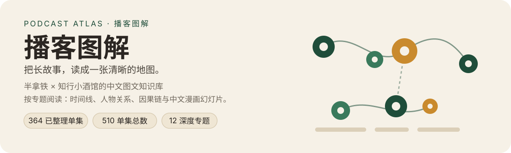
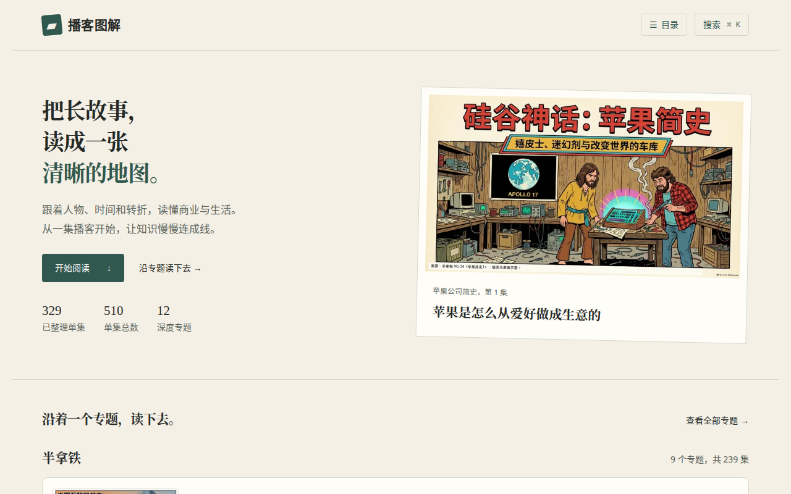

<p align="right"><a href="README.md">中文</a></p>

<p align="center">
  
</p>

<p align="center">
  <a href="https://xiaosang.cc/podcast-atlas/">▶ Read Online</a>
  ·
  <a href="https://github.com/holynova/podcast-atlas">GitHub Repository</a>
</p>

Podcast Atlas turns two Chinese podcasts — 半拿铁 Half Latte and 知行小酒馆 Zhixing Tavern — into a visual reading library: topic collections connect episode explainers, timelines, people, causal diagrams and illustrated Chinese slide decks. Each show has its own topic index; press Cmd/Ctrl+K to search titles, people and article text.

## Screenshot

<p align="center">
  
</p>

## Coverage

| Podcast | Topics | Episodes |
|---|---:|---:|
| 半拿铁 Half Latte | 9 | 239 |
| 知行小酒馆 Zhixing Tavern | 3 | 271 |
| **Total** | **12 in-depth topics** | **510 episodes, 329 explained** |

Counts follow the 329 episode explainers in the repo's `content/` and the live homepage stats (2026-11-17). Comic slide decks: 356 sets (PDF); illustrations: 2,494.

## What's in an Episode

- **Explainer article**: headline + intro + sectioned text, turning one long episode into a readable article.
- **Key takeaways**: the episode's core conclusions — read them first, then decide whether to read the full text.
- **Timeline**: events unfold in order, showing how causes led to effects step by step.
- **People**: short bios and relationships of everyone who appears, so a tangled cast is clear at a glance.
- **Causal chains & mechanisms**: why things happened the way they did, and the mechanisms behind them.
- **Glossary & caveats**: unfamiliar terms explained, plus notes on anything uncertain in the write-up.
- **Comic slide deck**: an illustrated Chinese slide deck (PDF), one visual telling the episode's main thread.
- **Original show link**: every episode keeps a link to the original show on Xiaoyuzhou, with a listen-back timestamp.

## How to Read

- **By topic**: start from 「沿着一个专题，读下去」 ("Follow a topic and keep reading") on the homepage and read a whole topic's episodes in sequence.
- **By episode**: the episode list loads in batches of 24, auto-loading more as you scroll to the bottom.
- **Search**: press Cmd/Ctrl+K to search titles, people and article text; search loads a lightweight index first, then fetches full text on demand.

## Run Locally

```bash
npm install
npm run build
npm run dev
```

Building cover thumbnails requires Pillow; pages use the system Chinese font. Content keeps growing on a five-hour cycle — text first, slide decks follow. Original transcripts live in a separate private project and are not uploaded to this site or repo.

## Structure

```
app.js                Frontend interactions: filters, search, lightbox
search.js             Search index chunk loading
style.css             Site-wide styles
config.json           Site config (domain, paths, production cadence)
content/              329 episode explainers (JSON, one per episode)
assets/slides/        356 comic slide decks (PDF)
assets/illustrations/ 2,494 comic illustrations (webp)
scripts/build.py      Build script: generates the static site
scripts/cycle.py      Production cycle script (one round every 5 hours)
scripts/pipeline.py   Content production pipeline
tests/                Search, production-cycle, and site-performance tests
vendor/               Built-in PDF reader
```

## Disclaimer

Explainers and comics are AI-assisted and may contain recognition or generation errors; each episode keeps a link to the original show and a listen-back timestamp. Full original transcripts are not part of the public site.
