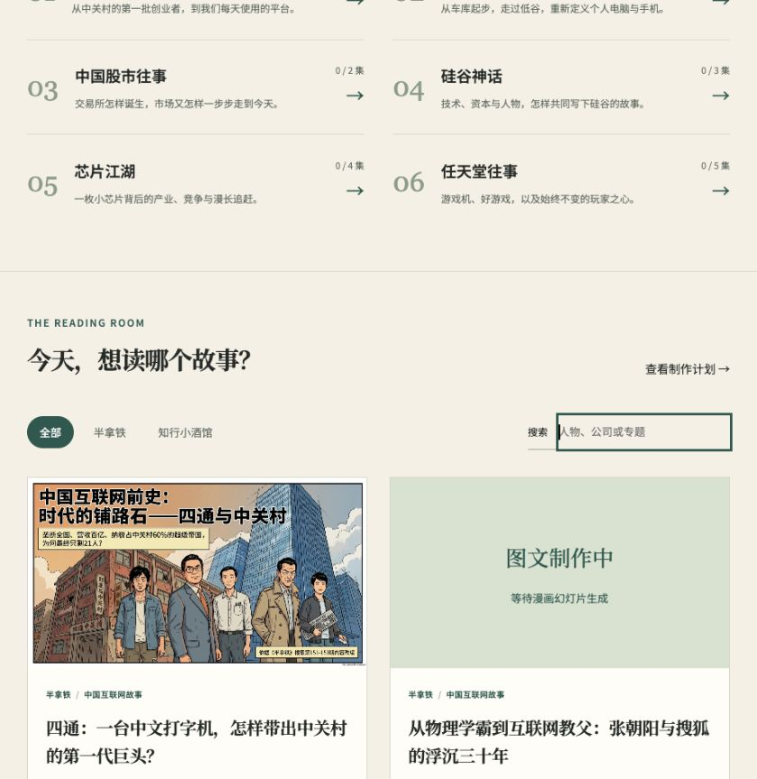

# 播客图解 / Podcast Atlas

把半拿铁、知行小酒馆的故事整理成中文图文知识库：按专题阅读，查看时间线、人物关系和因果链，搭配 NotebookLM 生成的详细漫画幻灯片。每天北京时间13:00目标制作10集，失败保留本地记录并续做。原始逐字稿留在独立私有数据项目中，不公开上传到本站或仓库。

A Chinese visual reading library for Half Latte and Zhixing Tavern podcasts. Topic collections connect episode explainers, timelines, people, causal diagrams and illustrated NotebookLM slide decks. A daily local task processes up to ten episodes, tracks each stage and resumes failed work. Original transcripts stay outside this repository and the public website.



- [Cloudflare Demo（待完成登录与上线验证 / pending verification）](https://xiaosang.cc/podcast-atlas/)
- [GitHub Repo](https://github.com/holynova/podcast-atlas)


## 本地运行 / Run locally

```bash
npm install
python3 scripts/pipeline.py run --limit 10 --wait-minutes 25
npm run build
npm run dev
```

See `config.json` for the read-only source directory, `PLAN.md` for production order and `state/progress.json` for local progress. NotebookLM requires an authenticated `nlm` CLI. PDF previews use the bundled Python/Pillow/pypdf and Poppler runtime paths configured in `scripts/render_slides.py`.

## 发布 / Deploy

```bash
npm run build
python3 scripts/check.py
npm run deploy:check
npm run deploy
```

Cloudflare Workers · Domain: `xiaosang.cc` · Route: `/podcast-atlas/`.
Use the sole `main` source branch and deploy locally from its committed, pushed state. No Cloudflare CI or Git integration. The daily Codex task invokes the same local workflow.

网页讲解与漫画为AI辅助整理，可能存在识别或生成错误；每集保留原节目入口及回听时间。完整原始逐字稿不属于公开产物。
