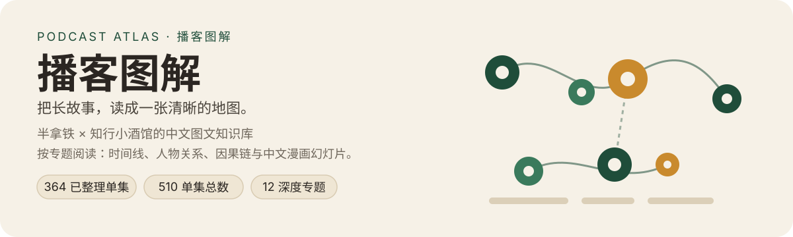
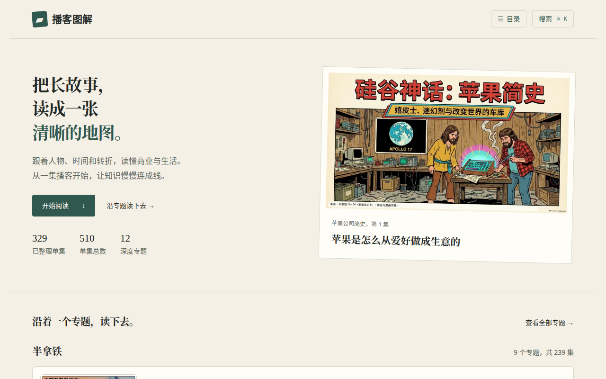

<p align="right"><a href="README.en.md">English</a></p>

<p align="center">
  
</p>

<p align="center">
  <a href="https://xiaosang.cc/podcast-atlas/">▶ 在线阅读</a>
  ·
  <a href="https://github.com/holynova/podcast-atlas">GitHub 仓库</a>
</p>

播客图解把半拿铁、知行小酒馆的故事整理成中文图文知识库：按专题阅读，每集有讲解正文、时间线、人物关系与因果链，搭配中文漫画幻灯片。两档播客各有专题目录，按 Cmd/Ctrl+K 可搜索标题、人物与讲解正文。

## 截图

<p align="center">
  
</p>

## 收录规模

| 播客 | 专题 | 单集 |
|---|---:|---:|
| 半拿铁 | 9 个 | 239 集 |
| 知行小酒馆 | 3 个 | 271 集 |
| **合计** | **12 个深度专题** | **510 集，364 集已整理** |

数量以仓库 `content/` 的 364 份单集讲解与线上首页统计为准（2026-11-22）。漫画幻灯片 426 套（PDF），插图 2,983 张。

## 每集包含什么

- **讲解正文**： headline + 导读 + 分节正文，把一集长故事讲成可读的文章。
- **要点**：一集的核心结论，先看要点再决定读不读全文。
- **时间线**：事件按时间展开，看到因果如何一步步发生。
- **人物**：出场人物小传与关系，复杂的人物网一图看清。
- **因果链与机制**：事情为什么会这样、背后的机制是什么。
- **术语与注意事项**：生词解释，以及整理时不确定的地方。
- **漫画幻灯片**：中文漫画风格的幻灯片（PDF），一集一图讲清主线。
- **原节目入口**：每集保留小宇宙原节目链接及回听时间。

## 阅读方式

- **按专题读**：首页「沿着一个专题，读下去」，从一个话题连续读完相关单集。
- **按单集读**：单集列表分批加载，每批 24 集，滚动到底自动续载。
- **搜索**：按 Cmd/Ctrl+K，搜标题、人物与讲解正文；搜索先加载轻量目录，再按需加载正文。

## 本地运行

```bash
npm install
npm run build
npm run dev
```

构建封面缩略图需要 Pillow；页面使用系统中文字体。内容持续更新，每 5 小时续做一轮：文字先发布，幻灯片逐步补齐。原始逐字稿留在独立的私有数据项目中，不公开上传到本站或仓库。

## 目录结构

```
app.js                前端交互：筛选、搜索、灯箱
search.js             搜索分片加载
style.css             全站样式
config.json           站点配置（域名、路径、生产节奏）
content/              364 份单集讲解（JSON，一集一份）
assets/slides/        426 套漫画幻灯片（PDF）
assets/illustrations/ 2,983 张漫画插图（webp）
scripts/build.py      构建脚本：生成静态站
scripts/cycle.py      生产周期脚本（每 5 小时一轮）
scripts/pipeline.py   内容生产流水线
tests/                搜索、生产周期与站点性能测试
vendor/               内置 PDF 阅读器
```

## 声明

网页讲解与漫画为 AI 辅助整理，可能存在识别或生成错误；每集保留原节目入口及回听时间。完整原始逐字稿不属于公开产物。

运行 `npm run build` 构建当前公开资料。在发布窗口将源码推送到 `main` 后，运行 `npm run deploy:check` 与 `npm run deploy`。

<a href="https://xiaosang.cc/podcast-atlas/"></a>
